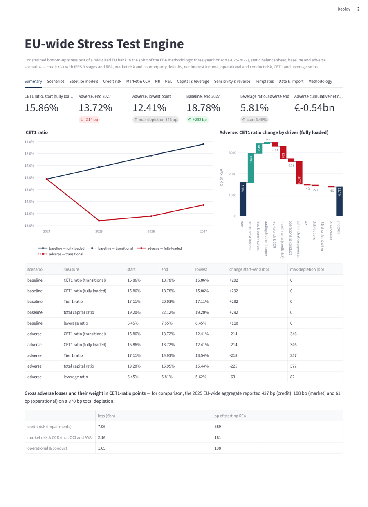
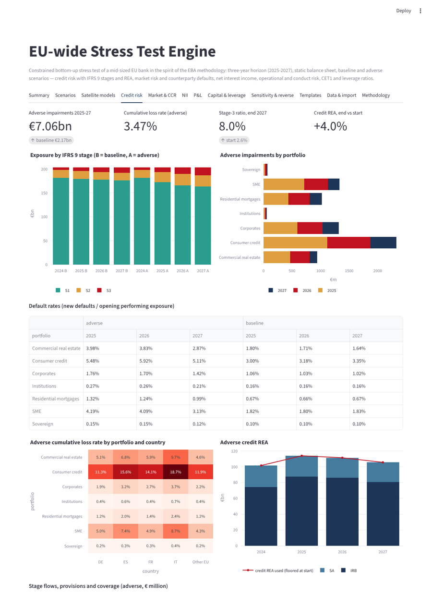
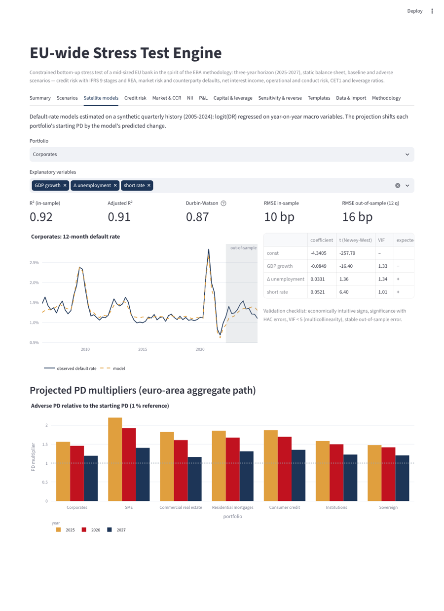
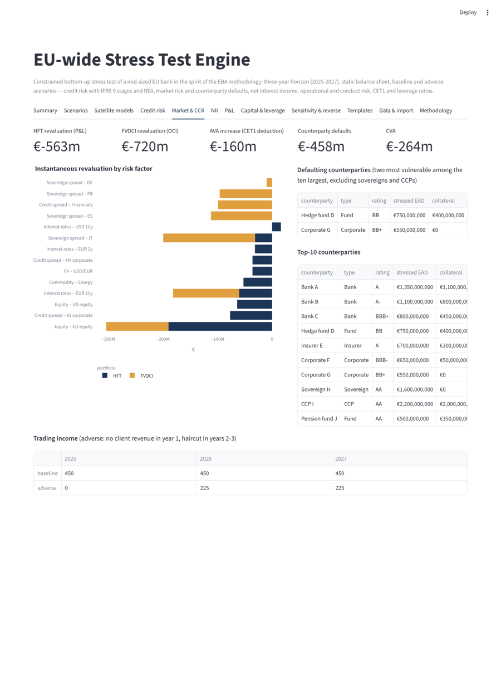
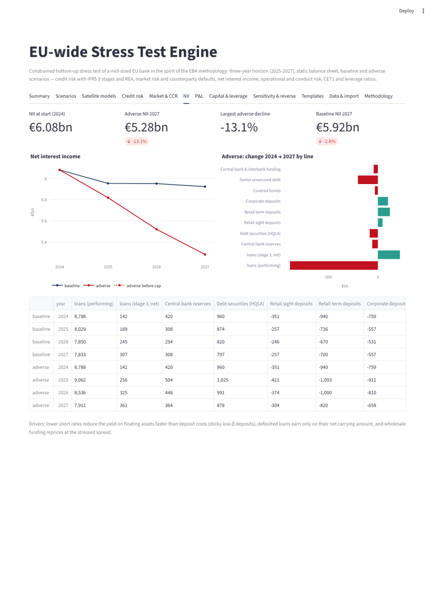
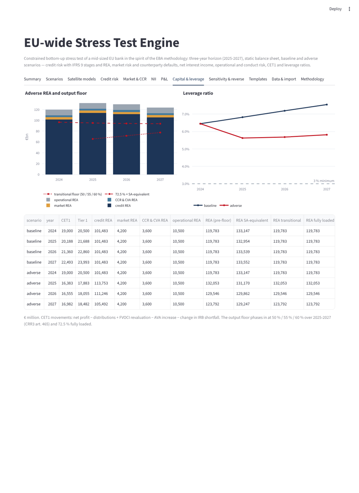
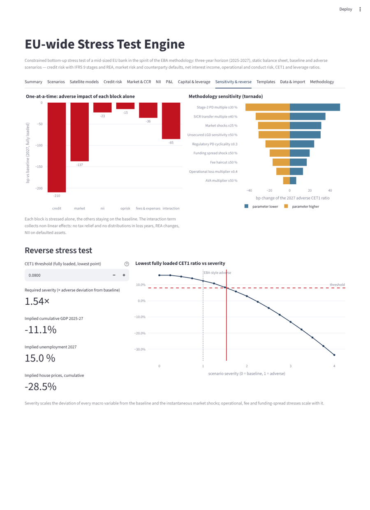

# EU-wide Stress Test Engine

A constrained bottom-up bank stress test in the spirit of the **EBA EU-wide stress test methodology**, built with Python and Streamlit. It projects a mid-sized EU bank over three years (2025-2027) under a baseline and an adverse scenario, with a static balance sheet. Five risk blocks are covered:

- **credit risk**: satellite models, IFRS 9 stage transitions, provisions, REA;
- **market risk and counterparty credit risk**: full-revaluation shock, AVA, default of the two most vulnerable counterparties, CVA;
- **net interest income**: pass-through, funding-spread shock, cap;
- **operational and conduct risk**;
- **the rest of the P&L**.

The engine produces CET1 (transitional and fully loaded) and leverage ratios, EBA-like result templates, and the sensitivity, one-at-a-time and reverse stress-test analyses.



## Reference methodology

The engine is modelled on the **2025 EU-wide stress test**, the latest finalised exercise:

- 64 banks;
- horizon 2025-2027;
- adverse scenario with a 6.3 % cumulative fall of EU GDP.

The published aggregate result was a CET1 depletion of 370 bp, to 12 % at the end of 2027. In CET1-ratio terms, credit risk weighed 437 bp, market risk 108 bp and operational risk 61 bp.

The EBA published the **draft methodology for the 2027 exercise** on 11 June 2026. That draft:

- cuts the data points by 55 %;
- adds a separate climate-risk module;
- keeps top-down (centralised) projections of NII and fees.

The default adverse scenario in the app is **illustrative**. It is calibrated on the headline figures of the 2025 ESRB adverse scenario:

- GDP −6.3 % cumulative;
- unemployment about 6 pp above baseline;
- inflation 5.0 / 3.5 / 1.9 %.

All other variables and the market shocks are plausible values, not the official scenario. Every scenario value is editable in the app.

## Synthetic bank

A €250bn-balance-sheet bank, starting CET1 ratio about 15.9 %:

- **Credit book**: seven portfolios × five countries, split into IRB and SA exposures, with stage 1/2/3 amounts, PIT and TTC PDs, LGD, coverage, margins and fixed-rate shares.
- **Market book**: fair-value sensitivities for held-for-trading and FVOCI positions, plus AVA and CVA.
- **Counterparties**: the ten largest.
- **Funding structure**: deposit betas and wholesale funding.
- **P&L**: starting-point items and historical operational and conduct losses.

## Model

| Block | Treatment |
|---|---|
| Satellite models | logit(default rate) on year-on-year macro variables, estimated on a synthetic 2005-2024 quarterly history. Diagnostics: Newey-West t, R², Durbin-Watson, VIF, sign check, out-of-sample backtest. Projection: logit shift of each portfolio's starting PD |
| IFRS 9 | Annual transitions S1→S2, S1→S3, S2→S3, S2→S1; no cure from S3 by default; defaulted exposures not replaced (static balance sheet). 12-month ECL for S1, lifetime ECL for S2, coverage for S3. Impairment = change in the provision stock |
| LGD | Secured portfolios: collateral model driven by house and commercial real estate prices. Unsecured: sensitivity to unemployment. Stage-3 coverage of the existing stock cannot decrease |
| Credit REA | SA on net exposures (defaulted assets at 100 % / 150 %). IRB risk-weight function with a regulatory PD that migrates with the PIT PD (cyclicality parameter). Credit REA floored at its starting value. IRB shortfall deducted from CET1 |
| Market & CCR | Instantaneous shock in year 1: HFT positions through P&L, FVOCI through OCI. AVA increase deducted from CET1. Default of the two most vulnerable of the ten largest counterparties (excluding sovereigns and CCPs). CVA on spread widening. Client trading revenues lost in year 1 and reduced afterwards |
| NII | Fixed and floating loans with client margins that cannot increase; stage-3 loans earn on their net amount. Deposit pass-through with a zero floor. Wholesale funding repricing at the stressed spread. Adverse NII capped at the starting level |
| Op & conduct | Historical average × adverse multiplier. Material conduct events booked in year 1. Operational REA held constant |
| Other P&L | Fees capped at the starting point and cut in the adverse scenario. Expenses indexed on scenario inflation and floored. Common tax rate with no tax credit on losses (option). Payout on positive profits |
| Capital | CET1_t = CET1_{t−1} + net profit − distributions + OCI − ΔAVA − ΔIRB shortfall. REA with the CRR3 output floor: 50 / 55 / 60 % transitional in 2025-2027, 72.5 % fully loaded. Leverage ratio on a static exposure measure |

## App tabs

| Tab | Content |
|---|---|
| Summary | CET1 trajectories, depletion waterfall by driver, ratio summary, gross losses vs the 2025 EU aggregate |
| Scenarios | Editable baseline and adverse paths, country severity multipliers, market shocks |
| Satellite models | Variable selection, estimation, diagnostics, backtest, PD multipliers |
| Credit risk | Stage evolution, impairments by portfolio, default rates, loss-rate heatmap by country, credit REA, stage flows and provisions |
| Market & CCR | Revaluation by factor (HFT vs FVOCI), defaulting counterparties, CVA, AVA, trading income |
| NII | Baseline vs adverse (before and after the cap), change by balance-sheet line |
| P&L | Full P&L for both scenarios, operational and conduct losses |
| Capital & leverage | REA by risk type and output floor, leverage ratio, capital table |
| Sensitivity & reverse | One-at-a-time block contributions, tornado on methodology parameters, reverse stress test (severity that brings the lowest CET1 ratio to a chosen threshold) |
| Templates | CSV_SUM, CSV_CAP, CSV_P&L, CSV_CR_SCEN, CSV_CR_PROV, CSV_CR_REA, CSV_MR, CSV_NII, CSV_OR — simplified layouts inspired by the EBA templates; Excel and CSV export |
| Data & import | Credit-book template and upload, market, funding and starting-point data |
| Methodology | Summary of the rules and the scope |

| | |
|---|---|
|  |  |
|  |  |
|  |  |

## Run

```bash
pip install -r requirements.txt
streamlit run app.py
```

Tests:

```bash
pip install -r requirements-dev.txt
pytest -q
```

The tests cover:

- scenario calibration;
- satellite signs and fit;
- static balance sheet;
- adverse worse than baseline;
- the NII cap;
- waterfall additivity;
- the CET1 accounting identity;
- REA floors and the output floor;
- the IRB reference risk weight;
- monotone stage 3 without cures;
- counterparty-default selection;
- reverse stress-test monotonicity and root;
- templates and Excel export;
- credit-file validation;
- an app smoke test.

## Project layout

```
stress/
  scenario.py     baseline / adverse paths, country severity, market shocks, scaling
  data.py         synthetic bank and credit-file validation
  satellite.py    synthetic history, logit default-rate models, diagnostics, PD projection
  credit.py       stage transitions, LGD, provisions, impairments, SA / IRB REA
  market.py       revaluation, AVA, counterparty defaults, CVA, trading income
  nii.py          net interest income with pass-through, funding spread and cap
  engine.py       P&L, capital, ratios, waterfall, one-at-a-time, reverse stress, tornado
  templates.py    EBA-like result tables and Excel export
app.py            Streamlit app
tests/            pytest suite
```

## Limits

- All data and the satellite history are synthetic.
- The methodology is a simplified reading of the EBA rules, not the official methodological note.
- These are not covered:
  - the 2027 climate module;
  - securitisations;
  - behavioural deposit models;
  - consolidation and minority interests;
  - P2R/P2G calibration.
- Market and CCR REA are held constant.

## License

MIT
